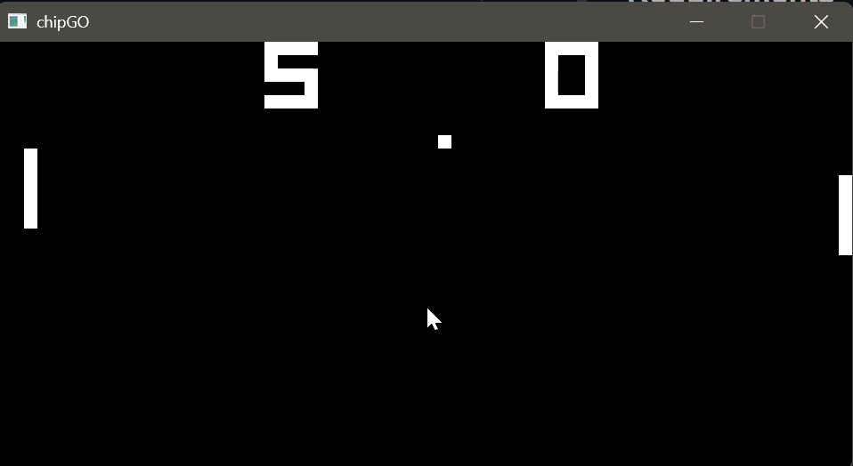

# chipGO

chipGO is a CHIP-8 emulator written in Go. It is a personal project for understanding emulation and hardware: how a small machine stores a program, fetches and decodes instructions, and drives a display, keypad, and timers as well as familiarizing myself with GO.

CHIP-8 is a simple virtual machine from the 1970s. Programs are loaded into memory, executed one opcode at a time, and drawn onto a 64×32 monochrome display. chipGO models that machine and renders it with [Ebiten](https://ebitengine.org/).

<p align="center">
  
</p>

## Requirements

- Go 1.27 or later

## Run

```bash
go run . path/to/rom.ch8
```

The window opens at 10× the native 64×32 resolution.

## Controls

The CHIP-8 keypad is mapped to the keyboard like this:

| CHIP-8 | `1` | `2` | `3` | `C` |
|--------|-----|-----|-----|-----|
| Key    | `1` | `2` | `3` | `4` |

| CHIP-8 | `4` | `5` | `6` | `D` |
|--------|-----|-----|-----|-----|
| Key    | `Q` | `W` | `E` | `R` |

| CHIP-8 | `7` | `8` | `9` | `E` |
|--------|-----|-----|-----|-----|
| Key    | `A` | `S` | `D` | `F` |

| CHIP-8 | `A` | `0` | `B` | `F` |
|--------|-----|-----|-----|-----|
| Key    | `Z` | `X` | `C` | `V` |

## Machine

The interpreter state lives on a `Chip` value:

| Field | Size | Role |
|-------|------|------|
| `memory` | 4096 bytes | Program, font, and RAM |
| `V` | 16 bytes | General-purpose registers `V0`–`VF`. `VF` is also the flag register |
| `index` | 16 bits | Address register `I` |
| `pc` | 16 bits | Program counter. Starts at `0x200` after a ROM is loaded |
| `stack` | 16 × 16 bits | Return addresses for `CALL` |
| `sp` | 8 bits | Stack pointer. The next free slot |
| `dt`, `st` | 8 bits each | Delay timer and sound timer |
| `keypad` | 16 bytes | One entry per key. Non-zero means held |
| `display` | 64 × 32 | Framebuffer. Each pixel is `0` or `1`. Kept outside `memory` |
| `opcode` | 16 bits | Instruction fetched on the current cycle |

Each frame runs up to 12 instructions, then decrements the timers. A draw instruction ends the burst early so sprites stay in step with the display. The sound timer counts down, but nothing is played yet.

## Memory

`memory` is a flat `[4096]uint8`, addressed from `0x000` through `0xFFF`. CHIP-8 treats the low 512 bytes as reserved for the interpreter, so programs are loaded at `0x200` and the rest of the array is RAM the program can read and write.

```
0x000 ┌─────────────────────────────┐
      │ unused                      │  interpreter area, left empty
0x050 ├─────────────────────────────┤
      │ font, 80 bytes              │  16 glyphs, 5 bytes each (0–F)
0x0A0 ├─────────────────────────────┤
      │ unused                      │
0x200 ├─────────────────────────────┤
      │ ROM, then free RAM          │  loadROM writes the file here
0xFFF └─────────────────────────────┘
```

`loadSprites` copies the font to `0x050` before the ROM is loaded. Each glyph is five bytes, one row per byte, with the high bit on the left. `FX29` points `I` at glyph `n` with `0x050 + n * 5`.

`loadROM` reads the file straight into `memory[0x200:]` and sets `pc` to `0x200`. Anything past the end of the ROM stays zero until an instruction writes it. `FX33`, `FX55`, and `FX65` are the instructions that use that space: binary-coded decimal digits, and bulk copies between `V0`–`Vx` and the bytes at `I`.

## Fetch and decode

A cycle reads one big-endian instruction and advances the program counter before it runs:

```
opcode = memory[pc] << 8 | memory[pc + 1]
pc += 2
```

The top nibble selects the group. The remaining nibbles are named the usual way:

| Piece | Mask | Meaning |
|-------|------|---------|
| `X` | `0x0F00` | Register index |
| `Y` | `0x00F0` | Second register index |
| `N` | `0x000F` | 4-bit immediate, usually a sprite height |
| `NN` | `0x00FF` | 8-bit immediate |
| `NNN` | `0x0FFF` | 12-bit address |

`0NNN` (`SYS addr`) is ignored. Only `00E0` and `00EE` are handled in that group.

## Opcodes

| Opcode | Mnemonic | Effect |
|--------|----------|--------|
| `00E0` | `CLS` | Clear the display |
| `00EE` | `RET` | Pop `pc` from the stack |
| `1NNN` | `JP addr` | Set `pc` to `NNN` |
| `2NNN` | `CALL addr` | Push `pc`, then jump to `NNN` |
| `3XNN` | `SE Vx, byte` | Skip the next instruction if `Vx == NN` |
| `4XNN` | `SNE Vx, byte` | Skip the next instruction if `Vx != NN` |
| `5XY0` | `SE Vx, Vy` | Skip the next instruction if `Vx == Vy` |
| `6XNN` | `LD Vx, byte` | `Vx = NN` |
| `7XNN` | `ADD Vx, byte` | `Vx += NN`. No carry flag |
| `8XY0` | `LD Vx, Vy` | `Vx = Vy` |
| `8XY1` | `OR Vx, Vy` | `Vx \|= Vy` |
| `8XY2` | `AND Vx, Vy` | `Vx &= Vy` |
| `8XY3` | `XOR Vx, Vy` | `Vx ^= Vy` |
| `8XY4` | `ADD Vx, Vy` | `Vx += Vy`. `VF` is 1 on overflow past `0xFF` |
| `8XY5` | `SUB Vx, Vy` | `Vx -= Vy`. `VF` is 1 when `Vx > Vy` before the subtract |
| `8XY6` | `SHR Vx` | `VF` is the low bit of `Vx`, then `Vx >>= 1`. `Vy` is not used |
| `8XY7` | `SUBN Vx, Vy` | `Vx = Vy - Vx`. `VF` is 1 when `Vy > Vx` before the subtract |
| `8XYE` | `SHL Vx` | `VF` is the high bit of `Vx`, then `Vx <<= 1`. `Vy` is not used |
| `9XY0` | `SNE Vx, Vy` | Skip the next instruction if `Vx != Vy` |
| `ANNN` | `LD I, addr` | `I = NNN` |
| `BNNN` | `JP V0, addr` | `pc = NNN + V0` |
| `CXNN` | `RND Vx, byte` | `Vx = random byte & NN` |
| `DXYN` | `DRW Vx, Vy, nibble` | XOR an `N`-byte sprite from `I` onto the display at `(Vx, Vy)`. See below |
| `EX9E` | `SKP Vx` | Skip the next instruction if key `Vx` is held |
| `EXA1` | `SKNP Vx` | Skip the next instruction if key `Vx` is not held |
| `FX07` | `LD Vx, DT` | `Vx = dt` |
| `FX0A` | `LD Vx, K` | Wait until a key is down, then store that key in `Vx`. While none is down, `pc` is rewound so this instruction runs again |
| `FX15` | `LD DT, Vx` | `dt = Vx` |
| `FX18` | `LD ST, Vx` | `st = Vx` |
| `FX1E` | `ADD I, Vx` | `I += Vx` |
| `FX29` | `LD F, Vx` | Point `I` at the font glyph for the low nibble of `Vx` |
| `FX33` | `LD B, Vx` | Store the hundreds, tens, and ones digits of `Vx` at `I`, `I+1`, and `I+2` |
| `FX55` | `LD [I], Vx` | Write `V0` through `Vx` into memory at `I`. `I` is left unchanged |
| `FX65` | `LD Vx, [I]` | Read memory at `I` into `V0` through `Vx`. `I` is left unchanged |

### Drawing

`DXYN` reads `N` bytes starting at `I`. Each byte is one row of eight pixels, high bit on the left. The sprite is XORed onto the framebuffer, so drawing the same sprite twice erases it. Coordinates wrap with modulo 64 and 32. `VF` is cleared first, then set to 1 if any pixel that was already on is turned off.
